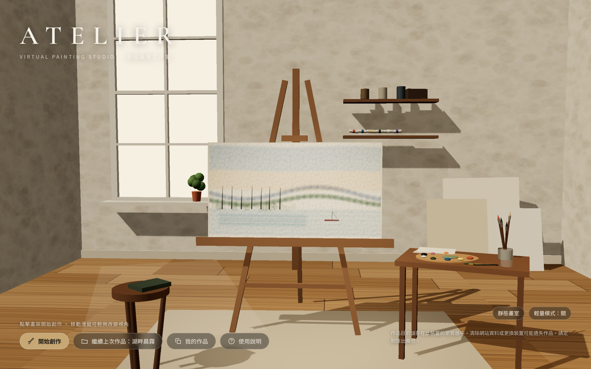
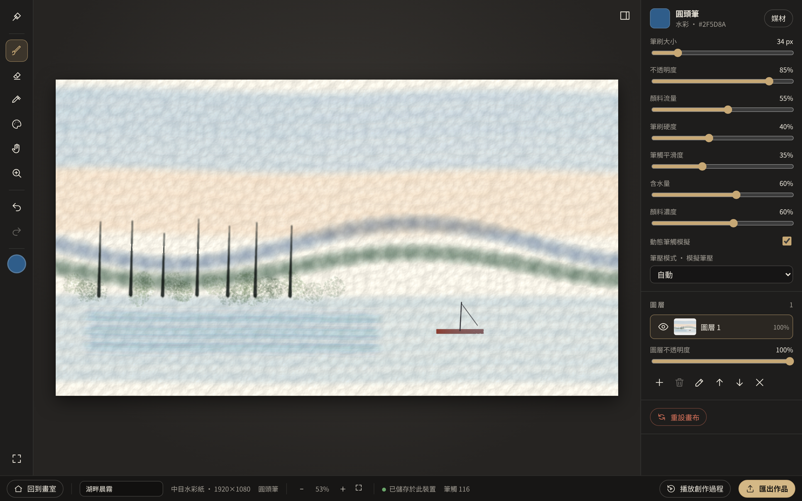
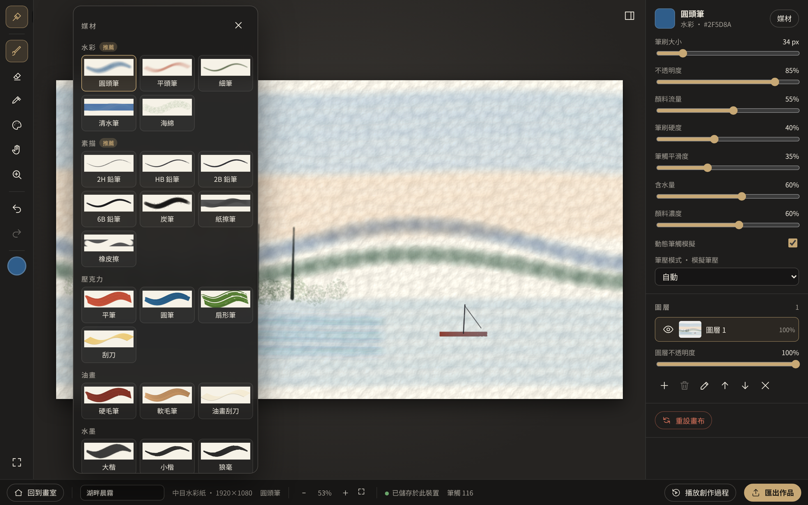
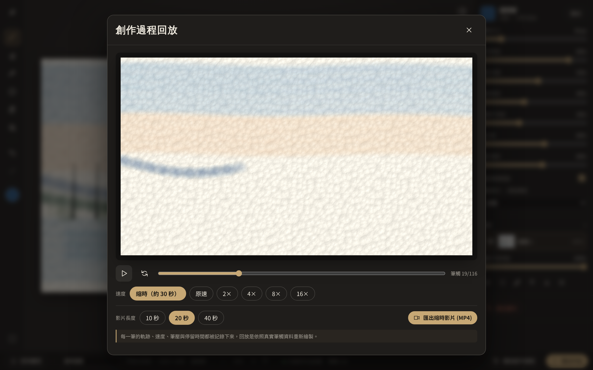

# ATELIER — Virtual Painting Studio

沉浸式專業虛擬繪畫工作室。免登入、免安裝，直接在瀏覽器中走進一間畫室，選擇紙張與畫布，用鉛筆、炭筆、水彩、水墨、壓克力與油畫創作，並可**回放整個創作過程、匯出縮時影片**。

- 公開網址（部署後）：`https://<GitHub 帳號>.github.io/virtual-painting-atelier/`
- 介面語言：繁體中文（台灣），i18n 架構已預留英文（`src/i18n/en.ts`）

> 作品目前儲存在此裝置的瀏覽器中（IndexedDB）。清除網站資料或更換裝置可能遺失作品，請定期匯出備份。作品**不會**同步至雲端。

| 畫室首頁 | 繪畫介面 |
|---|---|
|  |  |
| 媒材選擇（每張預覽都是引擎實際繪製） | 創作過程回放 |
|  |  |

## 已完成功能

**畫室（Scene 01）** — React Three Fiber 程序化建構的寫實畫室：木製畫架、窗戶日光與陰影、木地板、畫具桌（調色盤、筆筒、鉛筆、紙張）、層架、靠牆畫布、凳子。滑鼠視差、開場鏡頭推進、點擊畫架推近轉場。最新作品自動顯示在畫架上。低效能／觸控裝置自動輕量模式（無陰影、DPR 1），無 WebGL 時使用靜態 SVG 畫室。

**基底（Scene 02）** — 11 種基底：細紋／粗紋／灰色素描紙、細目／中目／粗目水彩紙、棉布／亞麻布／已打底畫布、生宣／熟宣。每種都有獨立的程序化高度圖（Worley、fBm、編織、纖維）與材質參數（粗糙度、吸收係數、擴散、附著、紙色、紋理種子）。尺寸 A5／A4／A3／正方形／16:9／自訂，可調方向、底色、紋理強度、吸收程度。

**媒材（Scene 03）** — 23 種可實際操作的工具，9 種獨立渲染器：

| 類別 | 工具 | 渲染器特徵 |
|---|---|---|
| 素描 | 2H、HB、2B、6B、炭筆、紙擦筆、橡皮擦 | 石墨依筆壓填入紙紋凹處、疊加加深、炭粉顆粒、推開暈染、擦除 |
| 水彩 | 圓頭、平頭、細筆、清水筆、海綿 | 半透明 multiply 疊色、收筆擴散、邊緣積色、顆粒沉澱、**濕中濕**（依濕潤地圖與乾燥時間）、清水洗淡並打濕紙面 |
| 壓克力 | 平筆、圓筆、扇形筆、刮刀 | 不透明覆蓋、刷毛紋理、厚塗明暗、顏料耗盡後乾刷只沾到紋理凸起 |
| 油畫 | 硬毛筆、軟毛筆、刮刀 | 同上，並從畫布沾取濕顏料混色（混色率高於壓克力） |
| 水墨 | 大楷、小楷、狼毫、羊毫、清水 | 刷毛束模型：輕壓只有筆鋒、重壓展開筆肚；墨量消耗形成枯筆飛白；含水量決定濃淡；生宣纖維暈染；停筆墨暈 |

**繪畫模式（Scene 04）** — 左側工具列（媒材、筆刷、橡皮擦、吸色器、調色、移動、放大鏡、復原／重做）；右側參數（大小、不透明度、流量、硬度、平滑度、含水量、顏料濃度、筆壓模式、圖層）；底部（紙張與媒材、縮放、儲存狀態、回到畫室、回放、匯出）。可收合面板與專注模式（Tab）。

**筆觸引擎**
- Pointer Events + Pointer Capture，優先 `getCoalescedEvents()`，未支援時退回單一事件
- Catmull-Rom 插值 + 依筆刷尺寸等距取樣，快速移動也不斷線；可調穩定器
- 筆壓三模式：A 固定、B 動態（速度＋停留時間，每種媒材獨立反應模型、起筆漸入、快速抬筆自然收筆）、C 繪圖筆（pressure、tiltX/Y）。滑鼠固定的 0.5 不會被當成真實筆壓；宣稱為筆但壓力恆定時自動改用模擬
- 停留不動時持續取樣，水彩積色暈開、墨暈、石墨加深
- 觸控：單指繪畫、雙指縮放平移互不衝突

**調色盤** — HSV 色盤、HEX／RGB 輸入、常用色、個人色票（儲存於瀏覽器）、2～3 色混色、從畫布吸色、前景／背景色切換（X）。

**圖層與歷史** — 新增、刪除、重新命名、顯示／隱藏、排序、不透明度、清除圖層、重設畫布；全部可復原。歷史紀錄只存「變化」（筆觸資料），不複製整張畫布；復原時從最近的快照檢查點重播之後的筆觸。

**儲存與匯出** — IndexedDB 自動儲存（含縮圖）、我的作品（開啟、複製、刪除確認、回放）、繼續上次作品、PNG／JPG（0.5×／1×／2× 輸出解析度）、可編輯專案檔 `.atelier.json`（版本號、格式驗證、圖層 PNG、所有筆觸資料、畫布與材質參數），可匯入繼續創作。

**創作過程錄製與回放** — 每一筆都保存軌跡點、時間、筆壓、傾斜、停留時間與亂數種子。回放是用同一個筆刷引擎依照真實筆觸資料重新繪製（不是擦除動畫）：可縮時（約 30 秒）或 1×～16× 播放、拖曳時間軸；長時間閒置會被壓縮。可匯出 10／20／40 秒縮時影片（MediaRecorder，瀏覽器支援時為 MP4，否則 WebM）。

## 技術與架構

React 19 · TypeScript · Vite · Three.js + React Three Fiber · Canvas 2D · Zustand · IndexedDB · Vitest · Playwright · GitHub Actions / Pages

```
src/
  app/                 App 與畫面切換
  components/          home / setup / paint / 共用 UI
  scenes/              StudioScene、Easel、Lighting、程序化貼圖（只負責空間呈現）
  painting/            與 UI 分離的繪畫引擎
    engine/            PaintingEngine、WetMap、序列化與格式驗證
    brushes/           筆刷預設與 9 種 StrokeRenderer（Brush/Material Engine）
    surfaces/          Surface Material 定義、高度圖生成、SurfaceRuntime
    strokes/           Stamper（插值取樣）、StrokeSession
    layers/ history/   圖層點陣、檢查點、History
    color/             色彩轉換、近似顏料混色
    replay/            ReplayPlayer（創作過程回放）
  input/               pointer（控制器、視圖轉換）、pressure（筆壓模擬）、smoothing
  storage/ export/ state/ i18n/ styles/ tests/
e2e/                   Playwright 瀏覽器測試
```

繪畫直接在文件解析度的 2D 畫布上進行，縮放／平移只是視圖轉換，所有指標座標都經同一個轉換映射回畫布座標；3D 場景不參與繪畫。

## 本機開發

```bash
npm ci
npm run dev          # http://localhost:5173/virtual-painting-atelier/
npm test             # Vitest 單元測試
npm run test:e2e     # Playwright（會先 build 再用 vite preview）
npm run build        # 產出 dist/
```

`BASE_PATH` 環境變數可覆寫 Vite base（預設 `/virtual-painting-atelier/`）。

## 部署到 GitHub Pages

`.github/workflows/deploy.yml` 會在推送到 `main` 時執行單元測試、瀏覽器測試、建置並部署。第一次需要：
1. 在 GitHub 建立 repository `virtual-painting-atelier` 並推送程式碼。
2. Repository → **Settings → Pages → Build and deployment → Source** 選 **GitHub Actions**。

## 模擬的限制（請務必閱讀）

- 媒材為即時**近似**模擬：水彩擴散用模糊與邊緣偵測近似，不是流體動力學；油畫厚塗用明暗筆跡模擬，沒有真實高度圖光照。
- 混色使用線性 RGB 幾何平均近似減色混合（藍＋黃會偏綠），**不是** Kubelka–Munk 顏料光學模型。
- 水彩、水墨的擴散在收筆後計算，繪製中看到的是預覽，收筆時會有輕微變化。
- 匯入他人專案檔時，若同 ID 已存在會另存為新作品。

## 已知問題 / 後續

見 [docs/STATUS.md](docs/STATUS.md)。

## 授權

程式碼採 MIT License（見 `LICENSE`）。第三方套件與字型授權見 `THIRD_PARTY_NOTICES.md`。本專案不含任何外部圖像或 3D 資產。
